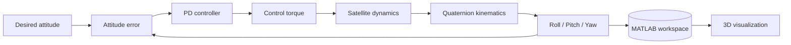

# 🛰️ Satellite Attitude Control — MATLAB/Simulink with 3D Visualization

Closed-loop **three-axis satellite attitude control** simulation in **MATLAB/Simulink** (quaternion kinematics + rigid-body dynamics + PD controller), with a **3D visualization script** that animates the satellite orientation from the simulation results.

Developed during an immersion internship at the **Satellite Development Center (CDS)**, Algerian Space Agency (ASAL), Oran — 01 to 15 September 2026.


---

## 📌 Overview

The goal of this project is to understand how **attitude sensors, control torques and satellite dynamics** work together in an ADCS (Attitude Determination and Control System).

The satellite starts with an initial orientation and the controller drives it to a desired roll, pitch and yaw. The simulation results are sent to the MATLAB workspace and then displayed in a 3D view.

| Part | Description |
|------|-------------|
| **Kinematics** | Quaternion propagation: `q̇ = ½ Ω(ω) q` |
| **Dynamics** | Rigid-body rotation: `I·ω̇ = −ω × (Iω + h) + T_ext + T_ctrl` |
| **Controller** | PD attitude controller (`Kp`, `Kd`) |
| **Visualization** | 3D animation of the satellite attitude (MATLAB script) |

## 🧩 Control loop


## 🎬 3D Visualization

[](https://www.linkedin.com/posts/abderraouf-brada-16bab632a_matlab-simulink-satellite-ugcPost-7509969728082194432-vg0t/?highlightedUpdateUrn=urn%3Ali%3Aactivity%3A7509969769119518720&highlightedUpdateType=SOCIAL_SHARE&origin=SOCIAL_SHARE&utm_source=share&utm_medium=member_android&rcm=ACoAAFMZvGMBeNow1kzSYz6IE3IL9L0CFQHpDNg)

*Click the image to watch the simulation video.*


## ⚙️ Simulation parameters

| Parameter | Value |
|-----------|-------|
| Initial attitude (roll, pitch, yaw) | `[0, 10, −5]` deg |
| Desired attitude (roll, pitch, yaw) | `[−10, 15, 45]` deg |
| Orbital angular velocity `ω_orb` | `[0, −0.0011, 0]` rad/s |
| Inertia matrix `J` | `diag(120, 113, 2)` kg·m² |
| Proportional gain `Kp` | `0.4` |
| Derivative gain `Kd` | `12.25` |

## 📊 Results

### Final attitude angles


### Attitude error


### Angular velocity


**Observations**

- The roll, pitch and yaw angles converge toward the desired attitude.
- The attitude error decreases toward zero, showing that the controller corrects the initial deviation.
- The angular velocity decays as the satellite approaches the desired attitude, showing stable damping.
- `Kp` sets the correction strength and `Kd` provides damping that reduces oscillations.

*(Add your measured values: settling time `__ s`, steady-state error `__ deg`, overshoot `__ %`.)*

## 📁 Repository structure

```
.
├── README.md
├── LICENSE
├── .gitignore
├── models/
│   └── YOUR_MODEL_NAME.slx          # Simulink attitude-control model
├── src/
│   └── YOUR_VISUALIZATION_SCRIPT.m  # 3D visualization (uses workspace variables)
├── results/
│   ├── final_angles.png
│   ├── attitude_error.png
│   ├── angular_velocity.png
│   └── 3d_visualization.png
├── images/
│   └── simulink_schematic.png
└── docs/
    └── Internship_Report.pdf
```

## 🚀 How to run

**Requirements:** MATLAB (R20XXx or newer) and Simulink. *(Add any extra toolbox you used.)*

1. Clone the repository and open MATLAB in its folder:
   ```bash
   git clone https://github.com/USERNAME/satellite-attitude-control.git
   ```
2. Open the model `models/YOUR_MODEL_NAME.slx`.
3. Click **Run** to simulate. The results are saved to the workspace by the *To Workspace* blocks.
4. Run the visualization script:
   ```matlab
   run('src/YOUR_VISUALIZATION_SCRIPT.m')
   ```

> ⚠️ The visualization script needs the simulation variables in the workspace, so **run the Simulink model first**. Required variables: `VARIABLE_NAME_1`, `VARIABLE_NAME_2` *(replace with your real names)*.

## 🔬 Theory behind the model

The attitude is represented by a quaternion `q = [q0 q1 q2 q3]ᵀ` with `‖q‖ = 1`.

**Kinematics:**

$$\dot{q} = \tfrac{1}{2}\,\Omega(\omega)\,q$$

**Dynamics:**

$$I\dot{\omega} = -\omega \times (I\omega + h) + T_{ext} + T_{ctrl}$$

where `I` is the inertia matrix, `ω` the angular velocity, `h` the reaction-wheel angular momentum, `T_ext` the external disturbance torque, and `T_ctrl` the control torque.

The full derivation, including Euler-to-quaternion conversion, the direction cosine matrix, and an Extended Kalman Filter with gyroscope bias estimation, is in the [internship report](docs/Internship_Report.pdf).

## 📖 What the internship report covers

- Satellite subsystems, missions, orbit types and Keplerian elements
- ADCS operating modes (detumbling, Sun acquisition, Earth pointing, safe mode)
- Attitude representations: Euler angles, quaternions, Rodrigues parameters
- Space perturbations: gravity gradient, aerodynamic, solar radiation pressure, magnetic
- Attitude sensors: magnetometer, Sun sensor, gyroscope, star tracker, Earth sensor, GPS, accelerometer
- Actuators: reaction wheels, magnetorquers, CMG, thrusters
- Satellite modelling and EKF with gyroscope bias estimation
- Visits at CDS: clean room and optoelectronics laboratory

## 🛣️ Future work

- [ ] Add environmental disturbance torques
- [ ] Add reaction-wheel and magnetorquer models with saturation
- [ ] Add sensor models and the EKF in the closed loop
- [ ] Compare PD with LQR or backstepping control
- [ ] Add detumbling with the B-dot algorithm

## 👤 Author

**Abderraouf Brada**
Micro and Nano Sensors and Instrumentation — National Higher School of Nanosciences and Nanotechnology (ENSNN), Algeria

Supervisor: Benfriha Elhassen, Senior Researcher, CDS

🔗 LinkedIn: `your-link` · ✉️ Email: `your-email`

## 🙏 Acknowledgements

Thanks to the Algerian Space Agency (ASAL) and the Satellite Development Center (CDS) for the internship opportunity and technical guidance.

## 📄 License

MIT License — see [LICENSE](LICENSE).
