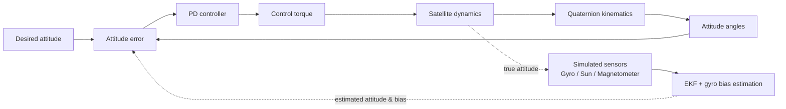

# 🛰️ Satellite Attitude Determination & Control — MATLAB/Simulink

Closed-loop **three-axis satellite attitude control** simulation (quaternion kinematics + rigid-body dynamics + PD controller), together with an **Extended Kalman Filter (EKF)** that estimates attitude and **gyroscope bias** from gyroscope, Sun sensor and magnetometer measurements.

Developed during an immersion internship at the **Satellite Development Center (CDS)**, Algerian Space Agency (ASAL), Oran — 01–15 September 2026.


---

## 📌 Overview

The goal is to understand how **attitude sensors, estimation, control torques and satellite dynamics** work together in an ADCS (Attitude Determination and Control System).

| Part | What it does |
|------|--------------|
| **Dynamics** | Rigid-body rotation: `I·ω̇ = −ω × (Iω + h) + T_ext + T_ctrl` |
| **Kinematics** | Quaternion propagation: `q̇ = ½ Ω(ω) q` |
| **Controller** | PD attitude controller (gains `Kp`, `Kd`) |
| **Estimator** | 7-state EKF: quaternion (4) + gyro bias (3) |
| **Sensors (simulated)** | 3-axis gyroscope, Sun sensor, magnetometer |

## 🧩 System architecture



> Adjust the diagram to match your exact Simulink connections (for example, whether the controller uses the true or the estimated attitude).

## ⚙️ Simulation parameters

| Parameter | Value |
|-----------|-------|
| Initial attitude (roll, pitch, yaw) | `[0, 10, −5]` deg |
| Desired attitude (roll, pitch, yaw) | `[−10, 15, 45]` deg |
| Orbital angular velocity `ω_orb` | `[0, −0.0011, 0]` rad/s |
| Inertia matrix `J` | `diag(120, 113, 2)` kg·m² |
| Controller gains | `Kp = 0.4`, `Kd = 12.25` |
| EKF initial covariance `P₀` | `1e-3 · I₇` |
| EKF process noise `Q` | `1e-6 · I₇` |
| EKF measurement noise `R` | `1e-3 · I₆` |
| Reference Sun vector `s_I` | `[1, 0, 0]ᵀ` |
| Reference magnetic vector `m_I` | `[0.2, 0.1, 0.45]ᵀ` |

## 📐 Mathematical model (summary)

**Quaternion kinematics**

$$\dot{q} = \tfrac{1}{2}\,\Omega(\omega)\,q, \qquad \|q\| = 1$$

**Rigid-body dynamics**

$$I\dot{\omega} = -\omega \times (I\omega + h) + T_{ext} + T_{ctrl}$$

**Gyroscope model and bias compensation**

$$\omega_{gyro} = \omega_{true} + b + n_g, \qquad \omega_{corr} = \omega_{gyro} - \hat{b}$$

**EKF measurement model**

$$s_{pred} = A(q)\,s_I, \qquad m_{pred} = A(q)\,m_I, \qquad r = \begin{bmatrix} s_{meas}-s_{pred} \\ m_{meas}-m_{pred} \end{bmatrix}$$

The measurement Jacobian `H` (6×7) is computed by finite differences (`δ = 1e-6`) with zero columns for the bias states. Full derivation is in the [internship report](docs/Internship_Report.pdf).

## 📊 Results

| Final attitude angles | Attitude error | Angular velocity |
|:---:|:---:|:---:|
|  |  |  |

**Key observations** *(fill in with your real numbers)*

- Settling time: `__ s`
- Steady-state error: `__ deg`
- Overshoot: `__ %`
- Gyro bias estimation error after convergence: `__ rad/s`

The derivative gain provides damping, the proportional gain sets the correction strength, and the angular velocity decays toward zero as the satellite reaches the desired attitude.

## 📁 Repository structure

```
.
├── README.md
├── LICENSE
├── .gitignore
├── src/
│   ├── init_params.m              # loads all parameters into the workspace
│   ├── run_simulation.m           # runs the model and saves the plots
│   └── ekf_attitude.m             # EKF MATLAB Function block code (if used)
├── models/
│   ├── satellite_attitude_control.slx
│   └── satellite_ekf.slx
├── results/
│   ├── final_angles.png
│   ├── attitude_error.png
│   └── angular_velocity.png
├── docs/
│   └── Internship_Report.pdf
└── images/
    └── simulink_schematic.png
```

*(Rename files to match your real ones.)*

## 🚀 How to run

**Requirements:** MATLAB (R20XXx or newer), Simulink. *(Add any toolboxes you used, e.g. Aerospace Blockset.)*

```matlab
% 1. Open MATLAB in the repository folder
cd path/to/satellite-attitude-control

% 2. Load the parameters
run('src/init_params.m')

% 3. Run the simulation
run('src/run_simulation.m')
% or open models/satellite_attitude_control.slx and press Run
```

## 🔭 Background covered in the internship

- Satellite subsystems, missions, orbits (LEO/MEO/GEO/SSO) and Keplerian elements
- ADCS operating modes (detumbling, Sun acquisition, Earth pointing, safe mode…)
- Attitude representations: Euler angles, quaternions, Rodrigues parameters
- Environmental torques: gravity gradient, aerodynamic, solar radiation pressure, magnetic
- Sensors: magnetometer, Sun sensor, gyroscope, star tracker, Earth/horizon sensor, GPS, accelerometer
- Actuators: reaction wheels, magnetorquers, CMG, thrusters
- Lab visits at CDS: clean room and optoelectronics laboratory (solar simulator, optical table, dark room)

## 🛣️ Future work

- [ ] Add environmental disturbance torques (gravity gradient, aerodynamic, SRP, magnetic)
- [ ] Add reaction-wheel and magnetorquer actuator models with saturation
- [ ] Add detumbling with the B-dot algorithm
- [ ] Replace the PD controller with LQR or backstepping and compare performance
- [ ] Add sensor bias/misalignment and an Unscented or Multiplicative EKF
- [ ] Python version of the simulation

## 📚 References

- Wertz, J. R. *Spacecraft Attitude Determination and Control*
- Boussadia, H. (2016). *Application de la technique Backstepping Adaptatif pour la commande d'attitude des satellites.* USTO-MB
- PW-Sat2 Team (2016). *Critical Design Review — Sun Sensor*
- McBryde & Lightsey. *A Star Tracker Design for CubeSats*
- Full list in the internship report.

## 👤 Author

**Abderraouf Brada**
Micro and Nano Sensors and Instrumentation — National Higher School of Nanosciences and Nanotechnology (ENSNN), Algeria

Supervisor: Benfriha Elhassen, Senior Researcher, CDS

🔗 LinkedIn: `your-link` · ✉️ Email: `your-email`

## 🙏 Acknowledgements

Thanks to the Algerian Space Agency (ASAL) and the Satellite Development Center (CDS) for the internship opportunity and technical guidance.

## 📄 License

MIT License — see [LICENSE](LICENSE).
